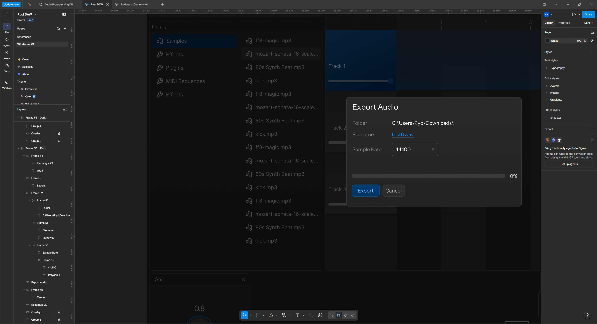
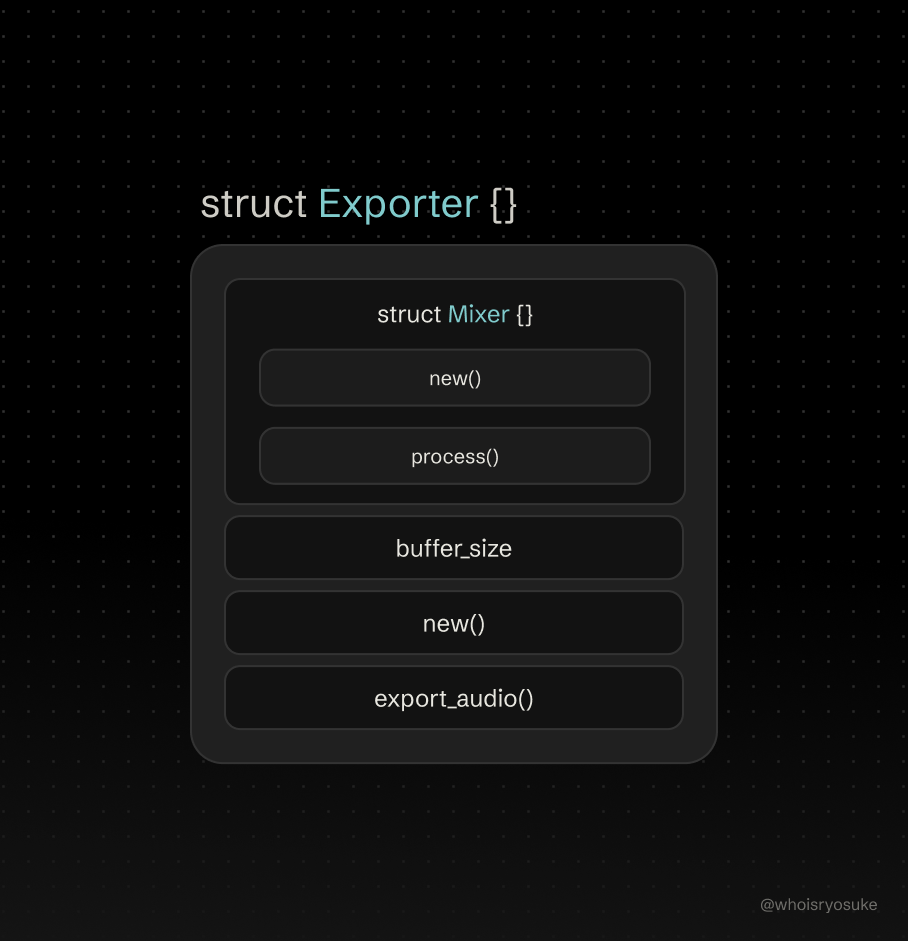
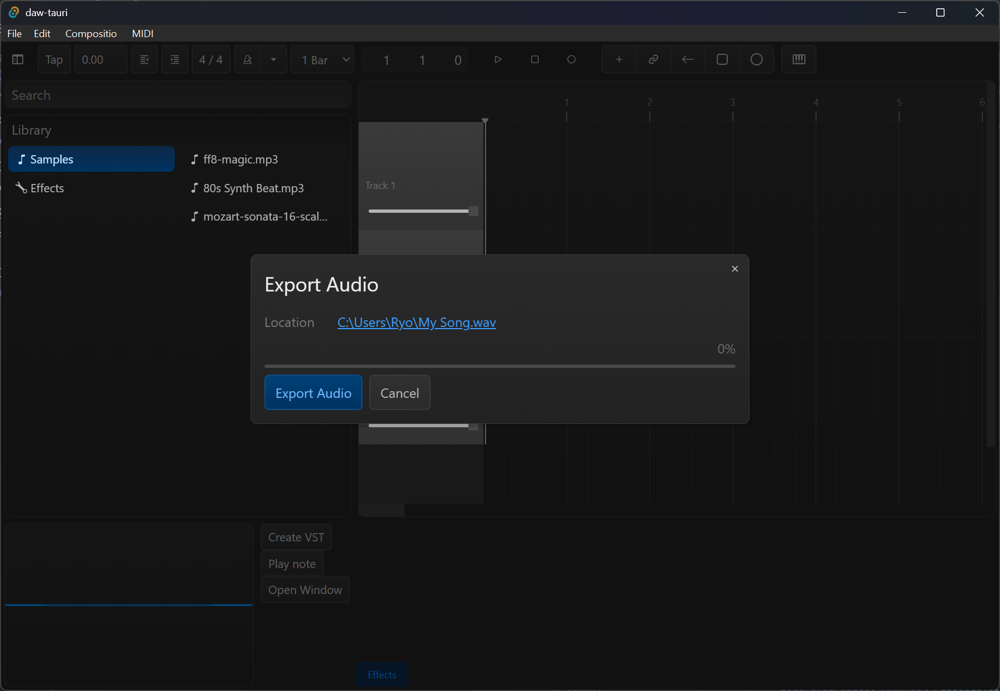

In a DAW, audio playback is essential, but what else is just as critical? Exporting audio. What’s the point of composing audio without a way to pull it outside of the app for other people to listen?

If you’ve been hanging around my blog for a bit you might have noticed I’m building a DAW in Rust. I’ve walked through the process of connecting to an audio device and sending music, to creating a multi-track timeline system for layering audio clips and effects. The app has come a long from where it started. But the one thing it can’t do is export audio.

In this blog I’ll go over how I developed a system to export audio files (like WAV or MP3) from the DAW by combining the timeline tracks into a single audio signal.

> 💡 This blog is part of a series where I build a DAW from scratch. I highly recommend checking out the [previous](https://whoisryosuke.com/blog/2026/creating-a-daw-in-rust/) [entries](https://whoisryosuke.com/blog/2026/creating-a-daw-in-rust-multi-track-timeline/) to get a better picture of where we’re at and what it took to get here. And if you’re new to audio, I’d recommend starting with another one of my [audio blogs](https://whoisryosuke.com/blog/tagged/audio/) since this dives deep and assumes you have the fundamentals down.

# What are we building?

We want to add a menu item so the user can click “File > Export Audio” and then generate an audio file that contains the entire timeline - from start to finish.



This requires a few steps:

- A frontend modal for the export settings (like selecting a location to save)
- Backend services for handling the export (grabbing all the audio data from the “timeline” and generating the actual audio file)
- And the most important part — refactoring existing backend services to allow for “offline” rendering. Currently our `AudioEngine` plays the `Composition` directly into the user’s speakers.

The first 2 are fairly straightforward to achieve - just making a modal UI and wrapping a 3rd party audio exporting library. The last one though? It’s a bit trickier when you take the current architecture into consideration.

# Exporting audio in Rust

Before we dive too deep into architecture and systems, let’s understand what we’re working with. We want to create an audio file in Rust and save it to the user’s PC.

When it comes to saving audio files, they’re binary, meaning they have algorithms associated with the data storage. For example, when we encode to MP3, it’s a lossless format because it uses a compression algorithm (alongside it’s encoding algo). To make it easier, we can use an existing library that understands the audio format and can “encode” our audio data to it.

For Rust, the easiest option is [hound](https://crates.io/crates/hound), a crate used for reading and writing to WAV files (aka encoding and decoding). This should work as a baseline, since most audio producers use WAV files an And for MP3, we can use [an MP3 encoding crate](https://crates.io/crates/mp3lame-encoder). I’ll be using the hound crate primarily to keep things simple.

Straight from the hound docs, we can see it’s fairly straightforward to write to a WAV file:

```rust
use std::f32::consts::PI;
use std::i16;
use hound;

let spec= hound::WavSpec {
    channels: 1,
    sample_rate: 44100,
    bits_per_sample: 16,
    sample_format: hound::SampleFormat::Int,
};
let mut writer= hound::WavWriter::create("sine.wav", spec).unwrap();
for tin (0 .. 44100).map(|x| xas f32 / 44100.0) {
    let sample= (t* 440.0 * 2.0 * PI).sin();
    let amplitude= i16::MAX as f32;
    writer.write_sample((sample* amplitude)as i16).unwrap();
}
```

We create a “spec” that lets the library know what kind of audio file we want (mono or stereo channels, the sample rate, etc). Then we can create a `WavWriter` struct that accepts a file path where we want to save the actual file. Then we can loop over each sample in our audio buffer and use `write_sample()` to save it to the file. When the writer is “dropped” in Rust (aka the function or thread finishes and the variable isn’t “moved” out of it), the file stream is closed.

> 💡 If you’re looking a this code and confused how I turned an audio file into a `for` loop of numbers or what a sample rate is, I recommend checking out my previous audio blogs where I break down low level audio programming in a bit more detail.

So if we wanted to create an exporter, we just need to have a function that runs this. We don’t even need to keep any of the structs we initialize around — it’s run and done. Let’s create an `Exporter` struct and add a `export_audio_file()` method to it. It’ll require the basic settings for the WAV file (like file path or sample rate), as well as the services we need to get our audio (`CompositionStore` and `AudioCache` in our case).

```rust
impl Exporter {
    pub fn export_audio_file(
        &mut self,
        app: AppHandle,
        composition: &CompositionStore,
        audio_cache: &AudioCache,
        sample_rate: u32,
        duration: f64,
        save_path: std::path::PathBuf,
    ) -> Result<(), String> {

        // Create file encoder
        let spec = hound::WavSpec {
            channels: channels as u16,
            sample_rate,
            bits_per_sample: 16,
            sample_format: hound::SampleFormat::Int,
        };

        let mut writer = hound::WavWriter::create(save_path, spec).map_err(|e| e.to_string())?;

        // Process audio on Mixer in blocks based on buffer size
        let mut output: Vec<f32> = vec![0.0; self.buffer_size];

        for _ in 0..segments {
            output.fill(0.0);

						// Run the mixer and process audio into output buffer

            // Write this block to disk
            for &sample in &output {
                let clamped = sample.clamp(-1.0, 1.0);
                let sample_i16 = (clamped * i16::MAX as f32) as i16;
                writer.write_sample(sample_i16).map_err(|e| e.to_string())?;
            }
        }

        Ok(())
    }
}
```

This is a nice start. Next up we need some audio data to put into the file.

# Fetching from the composition

We need 2 things from the composition:

- The total composition/timeline length (so we know how long the audio file is)
- Track clips and effects

## It’s timeline time

Actually it’s the timeline’s time technically. In order to generate our audio file, we need to know how long it is. In audio programming this is measured in frames - not seconds. We determine how many frames we need based on the time (usually in seconds) and the desired sample rate of the audio. The bigger the sample rate, the more frames we’ll need for each second.

So first we need how many “seconds” is the timeline in total. This means we need to loop through each track clip, check the start time and duration, and see if that’s the new end time.

> 💡 In the future we could also base this on a set range by the user (e.g. starting at 1 second and ending at 4:20 in). But for now (and as a nice sensible default) we’ll assume the audio file ends when the last clip finishes playing.

```rust
impl CompositionStore {
    pub fn get_composition_duration(&self) -> Result<f64, String> {
        let mut duration: f64 = 0.0;

        // Queue up clips to play
        // Loop through each track in the composition
        for (track_id, track) in self.tracks.iter() {
            // Grab track clips inside that track
            let Some(track_clips) = self.track_clips.get(track_id) else {
                println!("Couldn't load the track clips {}", track.name);
                continue;
            };

            // Grab the clips associated with track clip
            for track_clip in track_clips {
                // Get clip by ID
                let Some(clip) = self.clips.get(&track_clip.clip_id) else {
                    println!("Couldn't load the track clips {}", track.name);
                    continue;
                };

                // Calculate the end of the clip
                let total_time = track_clip.start_time + clip.duration;

                // Check if this clip end is biggest (meaning last clip)
                if total_time > duration {
                    duration = total_time;
                }
            }
        }

        Ok(duration)
    }
}
```

Now when we call an `export_file` Tauri command, we can get the duration before we run the export:

```rust

#[tauri::command()]
pub async fn export_file(
    app: AppHandle,
    composition_store: State<'_, Mutex<CompositionStore>>,
    asset_store: State<'_, AudioCache>,
    track_id: Option<String>,
    engine: State<'_, Mutex<AudioEngine>>,
    save_path: std::path::PathBuf,
) -> Result<(), String> {
    println!("Exporting file: {}", save_path.display());

    // Get sample rate
    let engine = engine.lock().map_err(|_| "Couldn't lock engine")?;
    let sample_rate = engine.config.sample_rate();

    // Grab composition
    let mut store = composition_store
        .lock()
        .map_err(|_| "Couldn't lock composition store")?;
    let duration = store.get_composition_duration()?;

    // Initialize the exporter
    let mut exporter = Exporter::new();
    exporter.export_audio_file(app, &store, &asset_store, sample_rate, duration, save_path)?;

    Ok(())
}

```

Then inside our `Exporter` we can use that `duration` (in seconds) to calculate the total number of “frames” (or “samples”) of audio we need. The seconds get converted to frames using the equation I mentioned earlier, then we multiply that by the number of channels. If we have 1 second of audio at 44,100 frames we need that for each channel, making it 88,200 total frames for 1 second of “stereo” audio (aka 2 channels).

```rust
// Calculate time to frames
let frames_per_channel = seconds_to_frames(duration, sample_rate)?;
let total_frames = (frames_per_channel as usize) * channels;
let segments = total_frames / self.buffer_size;
```

Using those `total_frames` we can calculate the number of `segments` we have, which translates to the number of loops of `process()` we’ll need to do.

> 💡 When we process our signal is interleaved (meaning 2 channels in 1 array like `[L, R, L, R]`). This means we can just loop over the `total_frames` because it’ll map the data out in the same pattern.



## Track clips and effects

Right now when the user presses play, the `AudioEngineMessaging` service has a `play()` method that runs and does the hard work of creating audio nodes for the `Mixer` to actually “play”. This involves grabbing all the tracks from the `CompositionStore`, then all the `TrackClip` associated with that track, then all the `Clip` associated with the track clip, then finally — it grabs the audio buffer from the `AudioCache` associated with the clip.

When I first wrote it, I was just focused on getting things to run, not necessarily focused on things the domain or context of the code. Instead of having all this logic inside the `AudioEngineMessaging` struct, it should live inside the `CompositionStore` since it involves all the data it controls. I added a `play()` method on it that grabs all the relevant track clips and effects sorted by track “ID”. This allows us to quickly call it and get all the track data we need:

```rust
impl CompositionStore {
		pub fn play(&self) -> (Vec<(usize, &TrackClip)>, Vec<(usize, &TrackEffect)>) {
		    let mut track_clips_result: Vec<(usize, &TrackClip)> = Vec::new();
		    let mut effects_result: Vec<(usize, &TrackEffect)> = Vec::new();

		    // Queue up clips to play
		    // Loop through each track in the composition
		    for (track_id, track) in self.tracks.iter() {

		      // You get the idea
		    }
		}
}
```

That simplified the logic inside the `Exporter`. I’m able to pass in the `CompositionStore` now, run that method, and quickly get the data I need. Then we can loop over all the track clips and effects and generate `AudioNode` and `EffectNode` for them (and subsequently add them to the `Mixer` later).

```rust
impl Exporter {
    pub fn export_audio_file(
        &mut self,
        app: AppHandle,
        composition: &CompositionStore,
        audio_cache: &AudioCache,
        sample_rate: u32,
        duration: f64,
        save_path: std::path::PathBuf,
    ) -> Result<(), String> {
        // Get all track clips and effects
        let (track_clips, effects) = composition.play();

        for (pool_index, track_clip) in track_clips {
            match track_clip.track_clip_type {
                TrackClipType::Sample => self.queue_sample(
                    pool_index,
                    track_clip,
                    composition,
                    audio_cache,
                    sample_rate,
                ),
                TrackClipType::Synthesizer => self.add_synth(pool_index, sample_rate),
            }
        }

        for (pool_index, item) in effects {
            self.mixer.add_fx_node(pool_index, item.effect.clone());
        }
    }
}
```

We’ve got some `AudioNode` to play, but we need to update our `Mixer` in order to play them because we have no way of getting them into it (since `tracks` are private and messaging handles adding nodes).

# Offline audio rendering

In order to get the audio data we need for exporting, we need to be able to run our audio processing layer “offline” - or basically in an isolated context. Right now, when the user presses play, we run the “rendering” (aka “processing”) which handles combining our audio clips and effects. Let’s take a step back and see how these things work together.

Our audio plays in the `AudioEngine` using a `Mixer` struct that lives inside the real-time audio thread, constantly feeding it the latest “audio nodes”. The `Mixer` handles the task of “mixing” all the audio clips and effects together. It is a reflection of the `Composition` - where it has “tracks” we can insert our audio “clips” (aka nodes) into and offset them as needed (like starting a sound at 2 seconds in).


Since it the `Mixer` lives in a separate thread that can’t be locked, it uses an `AudioEngineMessaging` service that allows the UI and backend to send command to the `Mixer` (like “play” or “pause”). We never talk to the `Mixer` directly, so it doesn’t have any methods on it for controlling it.


If we look at the current setup, we only really need the `Mixer` to do offline rendering. The `AudioEngine` is responsible for communicating with the user’s speakers - which we don’t need in this case. So how do we use our `Mixer` to play our audio on demand and return the data directly to us (instead of feeding it to the user’s speaker)?

## Let’s get mixing

Thankfully the way the `Mixer` is built it’s pretty isolated. When we initialize it, it only requires 1 “dependency”: the max size of the internal buffers. Since memory needs to be pre-allocated in a real-time audio thread, the `Mixer` requires a standard max “block” size (aka the biggest segment of audio samples we expect — usually in increments like 512, 1024, etc).


```rust

pub struct Exporter {
    buffer_size: usize,
    mixer: Mixer,
}
impl Exporter {
    pub fn new() -> Self {
        // Create the Mixer
        let buffer_size = 512;
        let mixer = Mixer::new(buffer_size);

        Self {
            mixer,
            buffer_size,
        }
    }
}
```

We can initialize the `Mixer` inside the `Exporter` and keep it stored in the struct for use later to actually process the audio.

Things do get a bit more complicated when we run the `process()` method of our `Mixer` though. This requires quite a few parameters:

```rust
impl Mixer {
    pub fn process(
        &mut self,
        output: &mut [f32],
        channels: usize,
        sample_rate: u32,
        waveform_producer: &mut Sender<f32>,
        playback_time: Arc<AtomicU64>,
    ) {}
}
```

Most of these we can easily provide in our `Exporter` — like the number of channels or the sample rate. But we also need to provide a `waveform_producer` and `playback_time`. The waveform variable isn’t as important, it’s just useful for debugging the audio signal. The playback time though — that’s crucial for the processing to work. In order for the `Mixer` to understand where it is on the timeline, we keep track of the the current “time” in frames (which we later use in `SampleNode` to know when they should start).

So we need to create both of these things in our `Exporter` so we can pass them in. We’ll create the `playback_time` in the initialization step - and the waveform when we export.

```rust
impl Exporter {
    pub fn new() -> Self {
        // Create the Mixer

        // Create shared variables
        let playback_time = Arc::new(AtomicU64::new(0));
        let total_frames = Arc::new(AtomicU64::new(0));
        let exporting = Arc::new(AtomicBool::new(false));

        Self {
            mixer,
            buffer_size,
            playback_time,
            total_frames,
            exporting,
        }
    }
}
```

And with that, we can run our `Mixer` inside the `Exporter`. But it’s still missing a few things. For example, we can run the `process()` method now but nothing will happen. This is because the `Mixer` has a `playing` flag we need to activate. Let’s set that up next.

## FS Method 180

Basically anything that we do using the messaging service, we should reflect it as a method we can directly control. Of course we could just create a mock messaging service and use that, but it’s much simpler (and better for testing later) to expose some functionality as independent struct methods.

This means we need a `play()` method to start playback before we run the `process()` method.

```rust
impl Exporter {
    pub fn export_audio_file(
        &mut self,
        app: AppHandle,
        composition: &CompositionStore,
        audio_cache: &AudioCache,
        sample_rate: u32,
        duration: f64,
        save_path: std::path::PathBuf,
    ) -> Result<(), String> {

        // Set Mixer to play
        self.mixer.play();

        // Process audio on Mixer in blocks based on buffer size
        let mut output: Vec<f32> = vec![0.0; self.buffer_size];

        for _ in 0..segments {
            self.mixer.process(
                &mut output,
                channels,
                sample_rate,
                &mut waveform_producer,
                self.playback_time.clone(),
            );

            // Write this block to disk
        }
    }
}
```

And we’ll also need methods to add audio nodes to mixer tracks (so we can do something with the audio nodes we made earlier from our composition).

```rust
impl Exporter {
    /// Creates a sample node and send to mixer
    fn create_sample_node(
        &mut self,
        samples: Arc<Vec<f32>>,
        start_time: u64,
        track_index: usize,
        track_clip_range: Option<(usize, usize)>,
    ) {
        let node = AudioNodeTypes::StaticBuffer(SampleNode::new(
            samples.clone(),
            start_time,
            track_clip_range,
        ));

        self.mixer.add_audio_node(track_index, node);
    }
}
```

And with that — our `Mixer` works now, and if you try exporting a file the whole composition should be saved as a `.wav` file. But we don’t know where that `.wav` file should be saved yet. Let’s create a UI modal for the user to select a location and then trigger the export.

# Export Modal

If you’re new the series, the UI of my app is ReactJS and HTML/CSS based (using Tauri and Vite as a bundler). I use Panda CSS for styling and Base UI for complex components (like the `<Modal>` we’ll see later).

To get the exporting to work, we need a place for the user to trigger the export process - and select a folder and filename for the file to export to.

## Modal system

In the DAW currently there’s only 1 modal, the settings modal. It was a place I added to let the user switch audio or MIDI devices, as well as manage any other app-level settings. Now we need another one though for the export. How do we ensure that the use only has 1 modal open at once? We don’t want them to be able to open the settings modal and then the export one — that’d stack them (along with their overlay) making the screen darker and harder to read. If we stack popups it’ll have a specific purpose.

The solution here is a simple store that keeps an ID of the current active modal.

```tsx
import { atom } from "jotai";

export const modalVisibleStore = atom<string>("");
```

This way in each modal, they can check if they’re visible by accessing this store:

```tsx
import React from "react";
import Modal from "../../ui/Modal/Modal";
import ExportModalContent from "./ExportModalContent";
import { useSetAtom } from "jotai";
import { modalVisibleStore } from "../../../store/app";

export const EXPORT_MODAL_ID = "EXPORT";

type Props = {};

const ExportModal = (props: Props) => {
  const setModalVisible = useSetAtom(modalVisibleStore);

  const handleClose = () => {
    setModalVisible("");
  };
  return (
    <Modal title="Export Audio" modalId={EXPORT_MODAL_ID}>
      <ExportModalContent close={handleClose} />
    </Modal>
  );
};

export default ExportModal;
```

Cool, now we can create our actual modal content.

## File > Export

Now we can add a new menu item using Tauris `Submenu` API. For the `action` we’ll use an `openModal` method that just updates the modal store with the ID the user passes. In this case, we use the `EXPORT_MODAL_ID`.

```rust
const fileSubmenu = await Submenu.new({
  text: "File",
  //   icon: menuIcon,
  items: [
	  // ... other menu items ...
    await MenuItem.new({
      id: "export_wav",
      text: "Export Composition as WAV",
      action: () => {
        openModal(EXPORT_MODAL_ID);
      },
    }),
  ],
});
```

Nice nice, we have a modal, we can open it. What goes inside though?

## Save As Popup

Inside the modal we’ll have a readonly `<input>` the user can click and set the output path of the audio file, then when the set it, the `<input>` will display it. Underneath we’ll have a `<button>` titled “Export”.

```tsx
import React, { useEffect, useRef, useState } from "react";
import {
  exportCompositionToAudioFile,
  saveAudioDialog,
} from "../../../services/export";
import { listen, UnlistenFn } from "@tauri-apps/api/event";
import Text from "../../ui/Typography/Text";
import { Stack } from "../../../../styled-system/jsx";
import Progress from "../../ui/Progress/Progress";
import { css } from "../../../../styled-system/css";
import Button from "../../ui/Button";

type Props = {
  close: () => void;
};

const ExportModalContent = ({ close, ...props }: Props) => {
  const [path, setPath] = useState<string>("");

  const handleStartExport = () => {
    // We'll handle this in a minute
  };

  const handleSelectFile = async () => {
    const newPath = await saveAudioDialog(path);
    if (newPath) setPath(newPath);
  };

  const isPathEmpty = isExporting || path == "";
  const isExportDisabled = isExporting || isPathEmpty;

  return (
    <Stack p={3}>
      <Stack flexDir="row">
        <Text className={subtitleStyle}>Path</Text>
        <input
          className={fileInputStyle}
          readOnly
          value={path}
          onClick={handleSelectFile}
        />
      </Stack>
      <Stack flexDir="row">
        <Button
          title={
            isPathEmpty
              ? "Select a place to save the file first"
              : "Exports audio to selected file"
          }
          colorPalette="blue"
          disabled={isExportDisabled}
          onClick={handleStartExport}
        >
          {isExporting ? "Exporting..." : "Export Audio"}
        </Button>
        <Button onClick={close}>Cancel</Button>
      </Stack>
    </Stack>
  );
};

export default ExportModalContent;
```

The `saveAudioDialog()` function uses Tauri’s Dialog API to popup a “Save As” file picker.

```tsx
import { save } from "@tauri-apps/plugin-dialog";

export async function saveAudioDialog(prevPath?: string) {
  const path = await save({
    title: "Save audio file as",

    // @TODO: Default to the composition name
    defaultPath: prevPath && prevPath !== "" ? prevPath : "My song",

    filters: [
      {
        name: "Audio Files",
        extensions: ["wav"],
      },
    ],
  });

  return path;
}
```

This returns a file path as a string - like `C:\Downloads\My Song.wav`.

We’ll pass this to our Tauri backend later and it’ll massage it into a `PathBuf` like we saw our `export_file` command requires.

## No postage required

With all this we have everything we need to get the export running. If the user selects a path, we can run the `export_file` backend command with the user’s selected path:

```tsx
export async function exportCompositionToAudioFile(path: string) {
  let result = await invoke("export_file", { savePath: path });

  console.log("export result", result);
}
```

And if they have clips in the timeline, they should be able to open the `.wav` file in the place they saved it and hear them. Cool right?

This is a decent start, but what if the user wanted to track the progress of the export? Usually when you export audio or video from an app you get a progress bar, and sometimes even an estimated duration.

# From 0 to 100%

Because audio and video files get larger and more complex than other file types, they also take more time to persist to disk, meaning it’s vital for the user to know how far along the process is. It provides the user more confidence and feedback in the process to ensure something is happening and the app isn’t just frozen.

How do we keep track of our export process and report back to the frontend? If you’ve followed along with this series you’ll already know the answer: MPSC channels and Tauri `AppHandle.emit()` feature.

When the user start the export process we’ll spawn a new thread. This thread will loop infinitely until the export is done, sending updates to the frontend the entire time.

```rust
impl Exporter {
    fn spawn_sync_thread(
        app: AppHandle,
        playback_time: Arc<AtomicU64>,
        total_frames: Arc<AtomicU64>,
        exporting: Arc<AtomicBool>,
    ) {
        thread::spawn(move || {
            // Keep thread alive as long as exporting flag is active
            while exporting.load(Ordering::SeqCst) {
                let total_frames = total_frames.load(Ordering::SeqCst) as f32;
                let playback_time = playback_time.load(Ordering::SeqCst) as f32;

                let _ = app.emit("export_time", playback_time / total_frames);

                thread::sleep(Duration::from_millis(16)); // ~60 FPS
            }
        });
    }
}
```

It basically just sends a percentage to the frontend as `export_time` starting at `0` and ending with `1`. The percentage is calculated using the current `playback_time` and the `total_frames`. Both are `Atomic` values which allow us to access them on the sync thread - as well as our export process.

Then in the export function itself, we store the total frames and the `exporting` flag. The `Mixer` handles updating the `playback_time`.

```rust
impl Exporter {
		pub fn export_audio_file(
		    &mut self,
		    app: AppHandle,
		    composition: &CompositionStore,
		    audio_cache: &AudioCache,
		    sample_rate: u32,
		    duration: f64,
		    save_path: std::path::PathBuf,
		) -> Result<(), String> {
				self.total_frames
				    .store(frames_per_channel as u64, Ordering::SeqCst);

				// Enable exporting flag
				self.exporting.store(true, Ordering::SeqCst);

				// Run processing

        // Done!
        // Clear flag (which ends sync thread)
        self.exporting.store(false, Ordering::SeqCst);

        Ok(())
		}
}
```

Now when the user exports we’re “emitting” the progress so the UI can “listen” to it:

```rust

const ExportModalContent = ({ close, ...props }: Props) => {
  const [progress, setProgress] = useState(0);
  const [isExporting, setIsExporting] = useState(false);
  const listenerRef = useRef<UnlistenFn>(null);

  // Get export progress from Rust backend
  useEffect(() => {
    if (isExporting) {
      const attachEvents = async () => {
        listenerRef.current = await listen("export_time", (event) => {
          // Returns a percent from 0-1
          setProgress(event.payload as number);
          console.log("got progress update", event.payload);
        });
      };

      attachEvents();
    }

    return () => {
      if (listenerRef.current) listenerRef.current();
    };
  }, [isExporting]);

  const handleStartExport = async () => {
    // Reset state + enable exporting flag
    setProgress(0);
    setIsExporting(true);

    await exportCompositionToAudioFile(path);

    // Finished? Push progress to end since sync misses it sometimesf
    setProgress(1);
    setIsExporting(false);
  };

  return(
      <Progress value={progress * 100} title=" " />
  );
};
```

Awesome! An export system, and a way for the UI to keep track of it.



# Audio in your hands

There’s so much you could add to a system like this. From exporting different file types (like MP3), to handling resampling audio if the output sample rate differs from the timeline.

Hopefully this provides you a bit of insight into the process of offline audio rendering. If not, you're probably a pro already! If that's the case I hope you enjoyed the light read lol.

As always, if you enjoyed this article, share it with your fellow audio nerds! And tell them to [follow](https://mastodon.gamedev.place/@whoisryosuke) [me](https://www.threads.com/@whoisryosuke) on [socials](https://bsky.app/profile/whoisryosuke.bsky.social) - that’s the best currency I could ask for. And if you want to support more blogs and open source work like this, consider [subscribing on Patreon](https://www.patreon.com/whoisryosuke).

Stay curious,
Ryo
