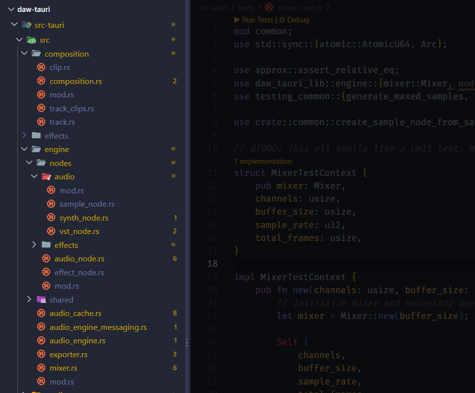

One of the most critical parts of creating production software is testing. It’s one of the best ways to immediately and consistently validate the code - usually before a build so you don’t ship a broken app. In audio apps this becomes even more crucial as you can imagine. With how much low level DSP math is happening, you need ways to verify there isn’t bad math somewhere ruining the sound output.

I’ve been [working on a DAW recently](https://whoisryosuke.com/blog/tagged/daw/) written in Rust and ReactJS, and it’s finally gotten to a point where testing makes a bit more sense as architecture solidifies and APIs aren’t changing constantly. So I spent some time cleaning house and correcting all the code I wrote for sake of simplicity (in exchange of scalability).

In the middle of the process I realized this might be interesting to others, so I thought I’d share how I added unit and integration testing to my DAW, as well as cover some basic techniques for testing audio. This one is great for people with beginner or intermediate experience with audio programming and looking to level up a bit. Along with some tips for Rust and Tauri peeps in general.

# Testing in my DAW

Before we dive into the why and how, I’ll provide a quick overview of what exactly I tested. Strap in fam, there’s going to be a lot of code and not a lot of visuals in this one.

My goal was to test the audio processing layer. This is the most important part of the system that needs validation, and is one of the easiest places for something to go wrong with how many moving pieces it has.

There are 2 parts here I focused on: `Mixer` and `SampleNode`.

```rust
pub struct Mixer {
    playback_nodes: Slab<AudioNodeTypes>,
    /// Maps MIDI keys to slab handles containing nodes
    playback_map: HashMap<u8, usize>,
    playback_process_buffer: Vec<f32>,
    /// Small collection to keep track of removed node IDs when they finish playing
    remove_node_handles: Vec<Option<usize>>,
    tracks: [MixerTrack; 20],
    playing: bool,
}
```

The `Mixer` is in charge of “mixing” all the audio and effects together, across all the different tracks in the timeline. It’s in charge of containing all the audio nodes and then when user plays audio - looping over them and running the `process()` method. For our `SampleNode`, which we’ll cover in a sec, it “processes” by copying it’s audio data to the output buffer passed into the process function. So this is a crucial place to test playback.

```rust
pub struct SampleNode {
    pub start_frame: u64,
    data: Arc<Vec<f32>>,
    position: usize,
    pub finished: bool,
    pub range: (usize, usize),
}
```

The `SampleNode` is in charge of containing sound data. When we load a `.mp3` file with a short sample, like a drum kick or a piano key, we place the audio “buffer” (aka audio data in `Vec<f32>` form) into a `SampleNode`. Then the `Mixer` can access that buffer data and use it to “play” the audio by copying it to a speaker’s output stream.

> 💡 If you’re interested in learning more about how all this works I recommend checking out the [previous blogs](https://whoisryosuke.com/blog/2026/creating-a-daw-in-rust-multi-track-timeline) in this series.

As you can imagine, both of these are critical parts of the playback system. I’ll be writing tests for each of these. The `SampleNode` will get unit tests. And for the `Mixer` - it’s probably technically a unit test, but I’ll be treating it as an integration test just to help me scaffold out that area (and because it has so many external dependencies involved in it’s initialization).

# The dirty work

The first step to enable a good testing environment was refactoring the application. I mentioned earlier I’d cut a lot of corners for sake of simplicity - that meant me making a 600+ line `audio_engine.rs` file that contains the `AudioEngine` - but also separate services like the `AudioEngineMessaging` or the `Mixer`.

Normally when refactoring a variable, you can press F2 and rename it and VSCode will rename it across all the files. So I figured “hey, they must have some tools for moving `struct` around into new files right? …right?”. Apparently not from my searches, so I was left manually refactoring. This might have been a good testing point for an LLM, but honestly this is a side project focused on learning, so it’d be a waste having a machine do my practice for me.



The process didn’t actually take too long. I just had to cut and paste out chunks into new files, then spend a little time searching for each reference of the `struct` across all files and updating the `use` import to the new destination (which was simplified by just deleting it, going to a missing reference, and letting the IDE find + import it).

There’s definitely something nice about having a place for everything, and everything in it’s place. And now unit testing should be much more clear, as we can test each `struct` individually.

# Testing the Mixer

The first thing I tested was the `Mixer`. When I built the WAV export process, I had to refactor the `Mixer` already to accommodate running it in isolation, because I needed it to do “offline rendering” of the audio. Makes sense right? The thing that plays audio to the speaker was essential to saving the same audio to a file.

After that refactor, and this one, it made the whole thing fairly straightforward. The test was basically what we did in the `Exporter` to render audio in isolation, but instead of using timeline data, we’ll be providing mock audio data.

I created a folder called `/tests/` in the root of the project, and inside I created `mixer_test.rs` file to contain the integration tests.

Inside we can define functions prefixed with the `#[test]` macro to create a test. Then inside we can use `assert!` macros to check if a test has passed (like if we play audio, we need to “assert” that it’s the same as the original audio). Usually you want your test names to be very descriptive. We’ll keep this one simple for now - does the `Mixer` play audio?

```rust

#[test]
fn mixer_plays_audio() {
```

Now we can initialize the `Mixer` and things we’ll need for processing later:

```rust
// Import the Mixer
use daw_tauri_lib::engine::mixer::Mixer;

// Initialize mixer and necessary dependencies
let mut mixer = Mixer::new(buffer_size);
// Mixer setup
let (mut waveform_producer, _) = crossbeam::channel::bounded::<f32>(1);
let playback_time = Arc::new(AtomicU64::new(0));

// Set Mixer to play
mixer.play();
```

> 💡 The one thing that wasn’t super clear at first was how to import things from the Tauri app, like the `Mixer` or any other types like `SampleNode`. Apparently in Tauri v2 they moved to using a setup where the app is defined in a `lib.rs` file now, instead of using a `main.rs`, which allows it to expose things as a library. The library takes it’s name from Tauri’s `Cargo.toml` and adds a `_lib` suffix. So for my `daw_tauri` app, it was `daw_tauri_lib`. Anything you want to expose to integration tests should be labeled as `pub mod` so it exports properly (that was one I forgot to do as well 😅).

Then just like the Exporter we built, we need to do “block processing” — which in audio programming terms, this means we’re going to loop and run the `Mixer.process()` method on a “chunk”. So if our audio is 1024 “samples”, we might loop in chunks of 512 samples — so it’d take 2 loops to “play” the audio completely.

And just like the Exporter, we need to define a total number of frames we want to loop over. You might think — hey if we have 1024 frames of audio, just loop that many times. But in audio programming, you don’t often have this luxury. The speaker sends over an `output` array for you to fill up, and it might be bigger or smaller each time. So part of our testing needs to validate the “chunk” based processing too.

We’ll generate “mock” audio data, so we can decide exactly how “long” in duration we want it to be. To keep things simple, we’ll make our sample 1 second long — which translates to 44,100 samples if the sample rate it 44.1k. We also need 2 channels of data for the left and right speakers in a standard stereo speakers (so `44,100 * 2`). Then we can define a standard block size (aka `buffer_size`) like `512` and figure out how many “chunks” we’ll need to process to completely “play” all frames of the audio.

```rust
// Audio settings
let channels = 2; // Stereo audio
let buffer_size = 512; // Standard small buffer
let sample_rate = 44100; // Standard sample rate (this many samples = 1 second)

// Calculate time to frames
// We do 0.5 seconds of playback
let total_frames = ((sample_rate / 2) as usize) * channels;
// Make sure to `ceil` while rounding to do more frames than needed (vs less)
let segments = total_frames.div_ceil(buffer_size);
```

> 💡 Importantly, we’ll use `ceil()` here because if we divide a `usize` number, it defaults to rounding to the lower integer (which results in our loop running short by a partial chunk). This also means we need to slice or `truncate()` our final signal later (you’ll see).

## Generating mock audio

Cool, so we have the `Mixer` initialized and ready to go, and we know how much audio data we need — how we generate mock audio data?

Well your first instinct might be to create a mock oscillator by generating sine wave data. That is a solid way to make audio data, but as we’ll see later, testing with floating point numbers is a bit more complicated than it initially seems. So how can we simplify the process?

What if we just generated audio where all the numbers are `1` or `0`. You could mix it up in a few different ways: all `1`s, all `0`s, or all `0` and a single `1` at the end. This allows us to test the mixer with very consistent data (no floating points), and it actually helps in a few cases.

For example, if we pass all `0` and then the output has something not `0` — we know that the `Mixer` (or something inside) is adding noise or corrupt data to our buffer. Or vice versa, we could throw in all `1` as samples and see if it comes out lower. If it does, we know something is “decaying” our signal.

Creating a function to generate this is pretty simple - we just provide a total number of frames (aka a “duration”) and loop over that number frames to create an array of well… `1` numbers.

```rust
pub fn generate_maxed_samples(duration_frames: usize) -> Vec<f32> {
    let samples = (0..duration_frames).map(|_| 1.0).collect::<Vec<f32>>();
    samples
}
```

> 💡 I’m sure real Rust-heads will look at this and optimize it down to something like `vec![1.0; duration_frames].collect()` or something, but for testing, this works fine too.

And if we needed a sine wave, we can generate one of those too, we just calculate the sine wave during the loop. It’s a simple algorithm, it’s `time * frequency * circle circumfrence`. Time in this case is our array index, and the frequency represents what pitch we’re targeting (in this case, an A4 piano note’s pitch).

```rust
pub fn generate_sine_samples(duration_frames: usize) -> Vec<f32> {
    let samples = (0..duration_frames)
        .map(|index| {
            let index = index as f32;
            let frequency = 440.0; // A4 note
            let sample = (index * frequency * 2.0 * PI).sin();
            sample
        })
        .collect::<Vec<f32>>();
    samples
}
```

## Sharing test utilities

Now I have a feeling we’re going to use these functions in all of our unit and integration tests. Most tests will be generating mock samples. So how can we share this between unit and integration tests?

The tricky part is how testing works in Rust.

- When you write **unit tests,** you write them inside your project, and they’re often in the same file as the `fn` or `struct` so you don’t have to import anything.
- When you write **integration tests,** they live outside the app’s `src/` folder, inside a `tests/` folder. The integration tests run in isolation, and you import anything you need from your Rust app (technically the “library” or `lib.rs`).

So the tricky bit is sharing code between the unit and integration tests. You can’t import code from the integration tests (`tests/`) to our unit tests (`src/some_file.rs`) - it just won’t work because the tests aren’t considered a “crate” or “library”. Or you could try sharing code from the unit tests to the integration side - which would work - but requires exposing the test utilities as part of your library’s bundle (aka `pub mod` inside your `lib.rs` file). Normally you don’t want to ship test code to the production bundle, meaning you’d need to implement some feature flags to get this working.

How do you share code easily then? The answer is Rust workspaces (aka a “monorepo”). We can create a crate with dedicated testing utilities, then install it to our main app as a `dev-dependency`, which allows you to use the code in testing modules and strip it away from production builds. No fuss, no feature flags required, just a little restructuring of the Rust/Tauri project.

I created a root `Cargo.toml` that has a `members` array with paths to each Rust project, in our case the Tauri app and our testing crate. I also need to add the testing crate to the `workspace.dependencies` to ensure that other crates can install it.

```toml
# Cargo.toml in project root

[workspace]
resolver = "2"
members = [
    "src-tauri",
    "crates/testing_common",
]

[workspace.dependencies]
testing_common = { path = "crates/testing_common" }
```

Created a new crate using the Cargo CLI:

```rust
cargo new --library crates/testing_common
```

Then in my Tauri app, I can add my testing crate:

```toml
# src-tauri/Cargo.toml

[dev-dependencies]
testing_common = { workspace = true }
```

And we can just export those function we created earlier, and import them into any unit and integration test now.

```rust
use testing_common::{generate_maxed_samples, DEFAULT_SAMPLE_RATE};
```

As you can see we can also export things like constants, useful for defining quick sensible defaults (like a sample rate in this case).

## Creating audio nodes

The `Mixer` works by storing `AudioNode` inside `MixerTrack` that reflect the tracks in the timeline. When we want to “play audio” we just need to create a `SampleNode` specifically and add that to a track.

```rust
// Add audio nodes to play
// We generate the samples here so we can compare them to result
let samples = generate_maxed_samples(total_frames);
let samples_ref = samples.clone();

// Create node
let node_samples = Arc::new(samples);
let node = create_sample_node_from_samples(node_samples);
mixer.add_audio_node(0, node);
```

> 💡 You’ll notice we use a `create_sample_node_from_samples()` function to create the sample node. This is a test utility we also share between tests — but I can’t keep it in the separate testing crate. It actually lives duplicated in 2 places, the app and the integration test folder. Why? Because this function requires `SampleNode` - which needs to be imported the app (where it lives). Since the separate testing crate doesn’t have access to the main app, we need to define the function locally inside the app project. To resolve the duplicate code in the future I should separate the business logic (like all the `AudioNode` types) into a separate crate and import that into the main app + testing crate.

## Mock block processing

With that, we can define a mock `output` array that’s limited to the block size, and pass that into the processing. Then when we finish processing, we’ll copy that `output` data into a `Vec` that’ll hold the entire signal (so we have something to compare at the end).

```rust
// Process audio on Mixer in blocks based on buffer size
let mut output: Vec<f32> = vec![0.0; buffer_size];
let mut final_signal: Vec<f32> = Vec::new();

for _ in 0..segments {
    output.fill(0.0);

    mixer.process(
        &mut output,
        channels,
        sample_rate,
        &mut waveform_producer,
        playback_time.clone(),
    );

    // Write this block to disk
    for &sample in &output {
        let clamped = sample.clamp(-1.0, 1.0);
        final_signal.push(clamped);
    }
}
```

Nice this works to process our audio, and then we can check if the final output is the same as the original output.

## Comparing floats

But wait, how do we do that? We have 2 arrays of float numbers (e.g. `[0.12332934, 0.494838389, ...]`). You can’t just assert that they’re equal (aka `assert_eq!`) - because the floating numbers may slightly differ in memory.

Instead, we can use the `approx` crate and it’s `asset_relative_eq!` macro to check if a float (or array of floats) is “close enough” to the other one. We can define an `epsilon` which is basically a “precision” — like saying we want numbers to be `0.00001` far apart at most.

```rust
// Compare original samples to final signal
// They should be equal - if not super close - since no calculations happen (besides merging signals)
let length = samples_ref.len();
assert_relative_eq!(
    final_signal.as_slice()[..length],
    samples_ref.as_slice(),
    epsilon = 1e-3
);
```

Also notice how I slice the array by the length of the original samples (the `[...length]` — not the `as_slice()` I know confusing). This is because the block processing will sometimes produce more samples in the final output than we need (a product of our `ceil()` earlier, we rounded up making extra samples). So we slice the array down, because if didnt and tried comparing them, not only are they different lengths - the output signal would have silence at the end (opposite of what we want here with our mock `1` filled audio buffer). Later you’ll notice I use a `truncate()` method to be more explicit.

Since we’re using whole numbers like `1` we technically don’t need this crate yet — but it’s nice to have in place for other float-based test cases.

This test should run and pass, which is great. It lets us know that audio is passing through appropriately. Though if you put together all the code you just read, it’d be a pretty big function. And we need to run the `Mixer` in other tests too. How can we reuse this logic?

## Test context

In testing, you often have to replicate a certain setup across tests. The `Mixer` is a great example, it’s a lot of song and dance just to get samples in and out.

Instead of doing that in every test function, we can create a `struct` in our testing file called `MixerTestContext` that handles all the logic of initializing and playing the audio - and we just have to provide minimal configuration (like our samples, or maybe a sample rate).

```rust
struct MixerTestContext {
    pub mixer: Mixer,
    channels: usize,
    buffer_size: usize,
    sample_rate: u32,
    total_frames: usize,
}
```

Now our test looks a lot more streamlined and understandable. We can easily see what the test is about without digging through `Mixer` setup.

```rust
fn mixer_plays_audio() {
    let total_frames = (DEFAULT_SAMPLE_RATE as usize) * 2;
    // Create Mixer
    let mut mixer_context = MixerTestContext::new(2, 512, DEFAULT_SAMPLE_RATE, total_frames);

    // We generate the samples here so we can compare them to result
    let samples = generate_maxed_samples(total_frames);

    // Add audio node to mixer and process signal
    let final_signal = mixer_context.process(samples.clone());

    // Compare original samples to final signal
    let length = samples.len();
    assert_relative_eq!(
        final_signal.as_slice()[..length],
        samples.as_slice(),
        epsilon = 1e-3
    );
}
```

If we wanted to test other `Mixer` features, it’s a lot easier now. Like say we wanted to test changing the gain of one of the tracks on the `Mixer` , it’s a couple extra lines:

```rust
#[test]
fn mixer_changes_track_gain() {
    let total_frames = (DEFAULT_SAMPLE_RATE as usize) * 2;
    // Create Mixer
    let mut mixer_context = MixerTestContext::new(2, 512, DEFAULT_SAMPLE_RATE, total_frames);
    // Set the first MixerTrack to `0.5` gain (half volume)
    mixer_context.mixer.set_mixer_track_gain(0, 0.5);

    // We generate the samples here so we can compare them to result
    let samples = generate_maxed_samples(total_frames);
    let effected_samples: Vec<f32> = samples.iter().map(|sample| sample * 0.5).collect();

    // Add audio node to mixer and process signal
    let final_signal = mixer_context.process(samples.clone());

    // Compare original samples to final signal
    let length = samples.len();
    assert_relative_eq!(
        final_signal.as_slice()[..length],
        effected_samples.as_slice(),
        epsilon = 1e-3
    );
}
```

We use `set_mixer_track_gain()` on the `Mixer` to change the `MixerTrack` gain (a function I had to add because previously it was controlled through a command buffer). Then this is where this is a bit different from the last test — since we’re changing our original samples, we can’t just compare the final samples to the original ones. We need to simulate the effect ourselves and then compare that. In this case we just `map()` over the samples and multiply by `0.5` (since the gain is `0.5`).

This handles our `Mixer` testing. And like I mentioned earlier, this is kinda still a unit test. To make it a true integration test, I should also bring in the `Composition` and use that for the audio data instead — so 2 or more services get mixed together. Ironically, it’s also just what I do in the Exporter (the feature that keeps on giving).

But what if we wanted a true “unit” test that’s co-located in a file with it’s `struct` or `fn`?

# Unit testing

What if we wanted to make a unit test for the `SampleNode`? Honestly it’s not that much different lol. We’ll even use the same test function to generate samples.

```rust

#[cfg(test)]
mod tests {
    use super::*;
    use approx::assert_relative_eq;
    use testing_common::{generate_maxed_samples, DEFAULT_SAMPLE_RATE};

    #[test]
    fn sample_plays() {
        let total_frames = (DEFAULT_SAMPLE_RATE as usize) * 2;
        let buffer_size = 512;
        let samples = generate_maxed_samples(total_frames);

        let mut node = SampleNode::new(Arc::new(samples.clone()), 0, None);

        // Make sure to `ceil` while rounding to do more frames than needed (vs less)
        let segments = total_frames.div_ceil(buffer_size);

        // Process audio in blocks based on buffer size
        let mut output: Vec<f32> = vec![0.0; buffer_size];
        let mut current_time: u64 = 0;

        let mut final_output: Vec<f32> = Vec::new();
        for _ in 0..segments {
            output.fill(0.0);
            node.process(&mut output, current_time);

            // Write this block to disk
            for &sample in &output {
                let clamped = sample.clamp(-1.0, 1.0);
                final_output.push(clamped);
            }

            // Increment time
            current_time += buffer_size as u64;
        }

        // Make signal length = to sample length
        final_output.truncate(total_frames);

        // Compare original samples to final signal
        assert_relative_eq!(final_output.as_slice(), samples.as_slice(), epsilon = 1e-3);
    }
}

```

We create the `SampleNode` with the mock samples, then we create a block processor workflow to simulate what the `Mixer` would be doing.

## Block Processing on demand

Like I said, very similar to the `Mixer` test. This clearly is showing that we need a utility test function for simulating block processing quickly.

We basically need to wrap up that logic that does the “chunk”-based loops and let the user pass a callback function to replace the `process()` method.

```rust
pub fn run_block_processing<F>(total_frames: usize, buffer_size: usize, mut process: F) -> Vec<f32>
where
    F: FnMut(&mut [f32], u64), // The trait bound for the callback
{
    // Make sure to `ceil` while rounding to do more frames than needed (vs less)
    let segments = total_frames.div_ceil(buffer_size);

    // Process audio in blocks based on buffer size
    let mut output: Vec<f32> = vec![0.0; buffer_size];
    let mut current_time: u64 = 0;

    let mut final_output: Vec<f32> = Vec::new();
    for _ in 0..segments {
        output.fill(0.0);

        // This should be a function user can pass
        process(&mut output, current_time);

        // Write this block to disk
        for &sample in &output {
            let clamped = sample.clamp(-1.0, 1.0);
            final_output.push(clamped);
        }

        // Increment time
        current_time += buffer_size as u64;
    }

    final_output
}

```

Now we can change our test to be as simple as:

```rust
#[test]
fn sample_plays() {
    // Generate samples
    let total_frames = (DEFAULT_SAMPLE_RATE as usize) * 2;
    let samples = generate_maxed_samples(total_frames);

    // Create the node
    let mut node = SampleNode::new(Arc::new(samples.clone()), 0, None);

    // Run block processing on node
    let mut final_output = run_block_processing(total_frames, 512, |output, current_frame| {
        node.process(output, current_frame);
    });

    // Make signal length = to sample length
    final_output.truncate(total_frames);

    // Compare original samples to final signal
    assert_relative_eq!(final_output.as_slice(), samples.as_slice(), epsilon = 1e-3);
}
```

# Variety is the spice of tests

The point of testing is variety, to ensure that you’re considering all the different use cases.

For audio testing, here’s a few easy ones to test for:

- You might have a test with `NaN` instead of proper numbers to see how the system handles bad data, or if it allows it to corrupt good audio data. You can use the [proptest](https://github.com/proptest-rs/proptest) crate help with this, it’ll run your test against a multitude of variations (like for us, it could generate good - and bad - numbers for audio data).
- Like I mentioned, I tested all `1`’s as my audio, next I could test all `0`’s next, or a sine wave to simulate more realistic conditions.
- We can test different scenarios - like can the `Mixer` handle mono audio instead of stereo? Or audio with a different sample rate? (The current answer is definitely not lol)
- We could render the waveform as a visualization and use it as a kind of “snapshot testing”. I covered this in [a previous blog.](https://whoisryosuke.com/blog/2025/visual-testing-for-rust-libraries/)
- You could create a baseline test audio file (like `test.wav`) programmatically encoding a buffer to disk or use an app like Audacity to define points manually. Then you can check against these constants. This one requires a lot of work - it’s much easier using mock data unless you’re specifically testing file loading and parsing as well.
- It’s not as related to the kind of testing we’ve been doing, though you could also test the “performance” of the code by using [a benchmarking library](https://github.com/criterion-rs/criterion.rs). It runs your test and keeps track of how fast it was, so you can compare it later and see how much faster/slower pieces of the app are getting.

I also will say I try not to add tests pre-emptively to a system because my architecture changes rapidly in the early stages. This makes testing more of a hindrance, having to go back and refactor more code (on top of the “real” code you have to update already). They’re also useful for LLM validation to be able to validate functionality in the app (since it can’t run the app and introspect without heavier headless browser frameworks or extensions).

I’ll probably do a few more refactors before I add an immense amount of testing because there’s a few breaking changes that need to happen (like better multi-channel support instead of hardcoding stereo audio).

# What’s next?

You could really spend forever working on a DAW, there’s so much to consider. It really makes you appreciate all the audio apps we have and how much work goes into making sure the audio plays (or records) smoothly and without any hiccups.

There’s still so much to add the DAW - from all the standard effects you expect to find like a Delay or Reverb, to so much UX to consider in the actual frontend of the app (like timeline editing workflows - I added a delete hotkey and that’s it - there’s so much people expect out of the box with that kind of experience). Stay tuned for more!

If you’ve enjoyed this blog, let me know on socials, always happy to hear when people read this stuff and find something interesting. And if you want to support more audio-focused blogs like this, consider contributing to my [Patreon](https://www.patreon.com/whoisryosuke).

Stay curious,<br />
Ryo
