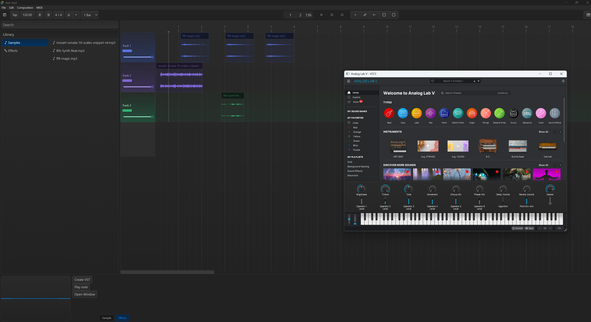
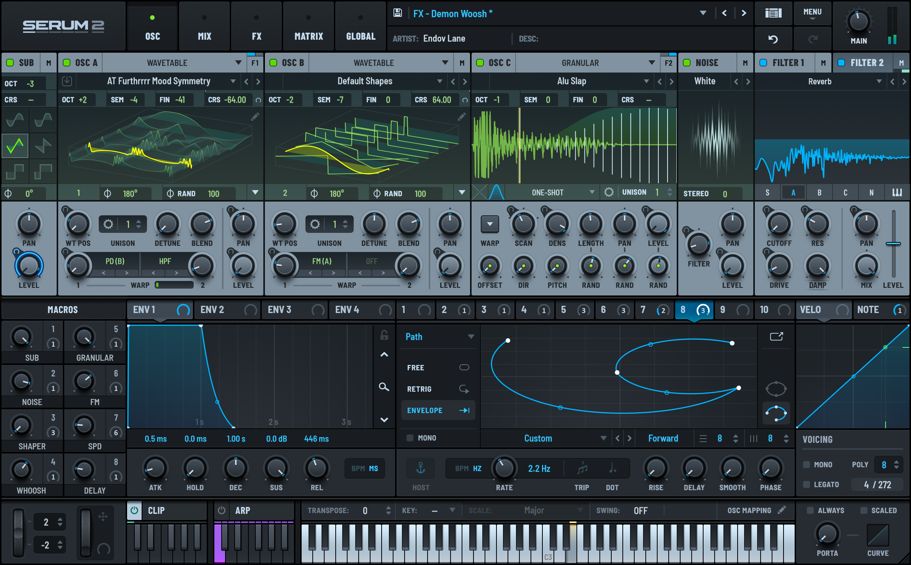
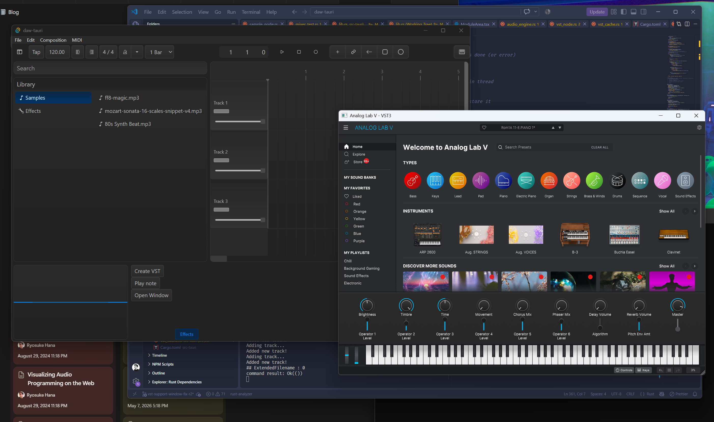

I’ve been tinkering away at a DAW in Rust and Tauri. Most recently I’ve added a multi-track timeline and MIDI support. So I figured, after MIDI, what else is essential for a producer? Plugins.

Plugins are a critical part of most production workflows, and when musicians spend so much money on them, they certainly expect their tools to support them. But how does it work actually adding them to your own app? I explored this journey and brought back tips and snacks form the trip for you.



In this blog I’ll break down what DAW plugins are and how I added VST3 plugin support to my Tauri app.

# Plugins?

Let’s start from the beginning. When we talk about plugins in music production, what are they?

If you’ve ever seen someone using a DAW and they popup a window that has UI that looks like an old wood panel, guitar, or other wild skeuomorphic elements — that’s probably a plugin.

They live as a file you download and import into your favorite native DAW (like Ableton, FL Studio, etc). This adds a new “plugin” to the DAW that you can run. When it runs, it might receives MIDI or audio input from the DAW and return audio buffers containing sounds. What it does depends on what the plugin’s goal is — some are “virtual instruments” playing sounds that mimic instruments based on MIDI input. Others could take in audio input and “effect” the audio, changing the sound.



That plugin file is a just a program made using native code, like C++ or Rust. Plugins come in a variety of formats - like [VST](https://en.wikipedia.org/wiki/Virtual_Studio_Technology) or [CLAP](https://en.wikipedia.org/wiki/CLever_Audio_Plug-in). You can imagine these as a the “function” that runs in between your audio or MIDI source and the audio output. It takes in the audio signal or MIDI events and does something. In some cases they load audio data from embedded files, or they generate it using a virtual synthesizer and DSP techniques.

 that emphasizes the skeuomorphic nature of the UI.](elottronix.jpg)

Historically, the [Steinberg company](https://www.steinberg.net/vst-instruments/) created [VSTs](https://en.wikipedia.org/wiki/Virtual_Studio_Technology) in 1996, which became an industry standard. In 2008 they released VST version 3.0, and more recently in 2013 they discontinued previous version of VST — making VST3 the de facto choice for VST plugin development. And even more recently in 2025, they properly [open sourced it](https://github.com/steinbergmedia/vst3sdk) under a MIT license (instead of their previously restrictive GPL3 iteration).

I chose it specifically because most of the plugins I use are in VST3 format, and it’s as future proof as it gets until they release VST 4.0 for whatever reason. And it’s cross-platform, compared to Apple’s [Audio Units](https://developer.apple.com/documentation/avfaudio/audio-units) format.

# VST3 in Rust

To support VST3 in Rust, we’ll need to use a crate that wraps the native C++ library by Steinberg. Lucky for us, there’s a [vst3 crate](https://crates.io/crates/vst3) that creates Rust bindings that lets us interface with the C++ code.

Though that still requires us to have a grasp of VST3’s C++ API so we can use it appropriately in our Rust code. Instead, we can use [`vst3_host`](https://github.com/HelgeSverre/rust-vst3-host), a crate that wraps `vst3` and provides an easier to use API (along with other things we need, like window management libraries for each platform).

You can see from the example in the [README](https://github.com/HelgeSverre/rust-vst3-host#vst3-host) how easy it is to load a plugin and play a note:

```rust
use vst3_host::{simple, midi::MidiChannel};

fn main() -> vst3_host::Result<()> {
    // Load a synth and start it playing through the default audio device.
    let plugin = simple::load_plugin("/Library/Audio/Plug-Ins/VST3/Dexed.vst3")?;
    let audio = simple::play(plugin)?;

    // Play middle C (MIDI note 60) for one second.
    audio.lock().send_midi_note(60, 100, MidiChannel::Ch1)?;
    std::thread::sleep(std::time::Duration::from_secs(1));
    Ok(())
}
```

## Let’s go deeper

As easy as that example was, it doesn’t exactly work for our use case. In that example, the plugin is loaded and it plays audio directly to the speakers. But we want our VST plugin as part of a chain of things, maybe we slap a couple effect nodes on it to change the way it sounds.

Still luckily, the crate supports using our own audio backend / method using a [“custom audio backend”](https://github.com/HelgeSverre/rust-vst3-host/blob/main/docs/how-to/custom-audio-backend.md#driving-the-plugin-yourself).

```rust
use vst3_host::{simple, AudioBuffers};
fn main() -> vst3_host::Result<()> {
	let mut plugin = simple::load_plugin("/x.vst3")?;
	plugin.start_processing()?;
	let mut buffers = AudioBuffers::new(0, 2, 512, 48000.0);  // 0 in, 2 out, 512 frames
	plugin.process_audio(&mut buffers)?;                       // buffers.outputs now holds the audio
	Ok(())
}
```

You can see we still load and initialize a `Plugin` instance, but we use it directly and call methods like `process_audio()` to get the input and output buffers from the plugin. The only requirement? We need to allocate memory for an `AudioBuffers` struct to store the buffer data from the VST plugin.

Not bad, let’s see how this fits into the bigger picture of our Tauri app.

# Integrating into the DAW

Cool, we’ve got a method to load and use VST3 plugins, now how do we add them to the DAW?

If you’ve been following along with the series so far, you’ll know that we have a low level `AudioEngine` in the Rust backend that uses the `cpal` crate. That allows us to connect to a user’s audio device and transmit our audio buffers to play sound (or receive them, if we’re recording a microphone).

The `AudioEngine` uses a `Mixer` that has “tracks” with `AudioNode` inside. The engine loops over all the tracks and nodes to generate audio.

Where does our VST plugin fit into this mix?

We’ll create a `VstNode` that will handle getting audio data from the plugin, we’ll need a `VstCache` to store the instance of the plugin to share across the app, and service to handle opening the VST plugin’s “window” (aka the little popup you see with custom plugin UI).

Let’s break each one down step by step.

> 📁 Here’s a link to [the source code](https://github.com/whoisryosuke/daw-tauri/tree/vst-support-window-fix-r2) if you want to look around and familiarize yourself with the existing architecture. There’s a lot of interweaved systems stacked on top of each other, so if this is your first time in this series, don’t feel overwhelmed and maybe check out [the first blog](https://whoisryosuke.com/blog/2026/creating-a-daw-in-rust/) before diving into this one.

## VST Node

We already have a system for supporting different audio node types (literally an enum called `AudioNodeTypes`). We can add a `VstNode` to that.

```rust
pub struct VstNode {
    plugin: Arc<std::sync::Mutex<vst3_host::Plugin>>,

    buffers: vst3_host::AudioBuffers,

    channel_count: usize,
    max_buffer_size: usize,

    started: bool,
    pub finished: bool,
    pub active: bool,
}
```

It’ll hold the instance of the `plugin` we need to do processing, as well as the pre-allocated `buffers` that hold the audio data. The only other property of note is the `active` flag which we can use to turn the VST processing on and off if needed (like when the user selects a different track).

Initializing the node is fairly straightforward, we take the `plugin` from the outside (I’ll cover that in a bit), and allocate the `AudioBuffers`. Since we usually create the audio nodes on a separate thread, we can use this opportunity to allocate some memory outside the RT audio thread.

```rust
impl VstNode {
    pub fn new(plugin: Arc<std::sync::Mutex<vst3_host::Plugin>>, sample_rate: f64) -> Self {
        let channel_count = 2;
        let max_buffer_size = 512;
        let buffers = vst3_host::AudioBuffers::new(0, channel_count, max_buffer_size, sample_rate);

        Self {
            plugin,
            buffers,
            max_buffer_size,
            channel_count,
            finished: false,
            started: false,
            active: true,
        }
    }
}
```

### Processing

Sweet, we’ve got a `VstNode`. Now let’s implement the `AudioNode` trait where the actual audio processing happens. If you haven’t been following along or need a refresher - this method takes in an audio buffer that we expect the node to write “samples” (aka audio data) to it.

```rust
impl AudioNode for VstNode {
    fn process(&mut self, output: &mut [f32], current_frame: u64) {
```

First we have to lock the plugin (required for something later…).

```rust
let mut result = self.plugin.try_lock();
```

Then if the node isn’t active, we need to stop processing. This saves some CPU so we don’t have plugins running unless we need them.

```rust
// Not active? Don't process
if !self.active {
    // End processing if needed
    if self.started {
        let _ = plugin.stop_processing();
        self.started = false;
    }
    return;
};
```

> 💡 To optimize code that runs in the RT audio thread, the goal is to minimize `if/else` blocks, and if you use `if` blocks - keep them deterministic. Using a struct property is good, because it probably won’t change between “blocks” (aka each time we call the audio callback). Although if you inspect my source code you’ll spot a big `match` I have to refactor out later lol.

Then before actually “process” audio (aka get music data from our plugin), we need to run a `start_processing()` method. We use a `started` flag on the struct to keep track of if it’s run or not to avoid re-running subsequently blocks.

```rust
// Start processor if we need
if !self.started {
    let _ = plugin.start_processing();
    self.started = true;
}
```

Now we need to resize our `AudioBuffers` we allocated earlier so they match the size of the current “block” (aka the length of the `output` array) - but divided by the channel count because the buffer is interleaved (aka “stereo” audio like `[L, R, L, R]` ). If we don’t resize the buffer, we’ll get more data than we need and we’ll need to manage it (meaning more work and memory allocation). This way, we get exactly how much we need to override the output buffer.

```rust
// Block size (for single channel - since output is interleaved)
// Ideally should be using output channels, but since VST matches it, we should be ok
let block_size = (output.len() / self.channel_count).min(self.max_buffer_size);

// Resize buffers to block size
for ch in &mut self.buffers.outputs {
    ch.resize(block_size, 0.0);
}
for ch in &mut self.buffers.inputs {
    ch.resize(block_size, 0.0);
}
```

Finally we can run the processing to get the latest audio data:

```rust
// Run the processor and get VST data
let _ = plugin.process_audio(&mut self.buffers);
```

When we run that, the `AudioBuffers` we created earlier get filled with new audio data. Let’s loop over that and override the `output` to “play” the audio.

```rust
// Override the output with VST output
let mut sample_index = 0;
for sample in output.iter_mut() {
    for ch in 0..self.channel_count {
        let new_sample = self.buffers.outputs[ch][sample_index];
        *sample = new_sample;
    }
    sample_index = (sample_index + 1).min(block_size - 1);
}
```

> 💡 Instead of doing a `if` statement here to check if we’ve reached the maximum sample index, we just use a `min()` method to limit it to the max size. Ideally we’d never exceed it anyway because we resize our array earlier, but we still need some sort of check if we’re incrementing an index.

And that’s a big chunk of it honestly. To test it, add the audio node to the immediate playback queue and send it a MIDI signal using the `send_midi_event()` method on the `Plugin` instance:

```rust
// Create a MIDI event to play a note
let event = vst3_host::MidiEvent::NoteOn {
    channel: vst3_host::MidiChannel::Ch1,
    note: 60,
    velocity: 100,
};
plugin.send_midi_event(event);
```

But let’s see how this would work practically in the Tauri app.

## VST Cache

Just like our audio samples, we need a place to load and store them. Unlike our audio samples, each `VstNode` will only have 1 plugin, there won’t be a need to have 1 plugin for multiple nodes. Though because we need to manage the plugin’s window, we still need to keep the plugin instance separate from the node. It also makes it easier to access, allowing us to run MIDI events from this cache instead of having to dig into our audio node (living in the protected RT audio thread).

```rust
pub struct VstCache {
    pub plugins: HashMap<String, VstPlugin>,
}
```

What’s a `VstPlugin`? Just a little wrapper around the `Plugin` we loaded earlier. This lets us add metadata later if needed, like a `name` or anything vital in the backend. I also created a convenience type wrapper around the `Arc<Mutex<Plugin>>` so I didn’t have to write that 500 times (and making it slightly easier to change out later if we swap VST crates).

```rust
pub type VstPluginInstance = Arc<Mutex<vst3_host::Plugin>>;

pub struct VstPlugin {
    pub plugin: VstPluginInstance,
}
```

This struct can also handle the responsibility of loading the VSTs, since it’s the cache for them anyway. Nothing wild here, same code from the example, we just insert the `VstPlugin` into a `HashMap` based on an ID the user passes (ideally a random UUID - since we may want to load the same plugin multiple times with different settings/params).

```rust
pub fn load_plugin<P: AsRef<Path>>(
    &mut self,
    id: String,
    path: P,
) -> Result<VstPluginInstance, String> {
    let plugin =
        vst3_host::simple::load_plugin(path)
            .map_err(|e| e.to_string())?;
    let plugin = Arc::new(std::sync::Mutex::new(plugin));

    let plugin_data = VstPlugin {
        plugin: plugin.clone(),
    };

    self.plugins.insert(id, plugin_data);

    Ok(plugin.clone())
}
```

That handles loading the plugin. Let’s try playing some music using the plugin.

## Creating a VST Node

We have a node, we have a cache for the plugin, that’s technically all we need for now. We can create a new plugin, put it in the `VstCache`, then create a `VstNode` with it.

```rust

#[tauri::command]
fn create_vst(
    engine: State<'_, Mutex<AudioEngine>>,
    messaging: State<'_, AudioEngineMessaging>,
    vst_cache: State<'_, Mutex<VstCache>>,
) -> Result<(), String> {
    let engine = engine.lock().map_err(|_| "Couldn't lock engine")?;

    // Get samples from cache
    let sample_rate = engine.config.sample_rate();

    // Create plugin and store in cache
    let mut vst_cache = vst_cache.lock().map_err(|_| "Couldn't lock VST cache")?;

    let plugin = vst_cache.load_plugin("test".to_string(), "".to_string())?;

    messaging.create_vst_node(0, sample_rate as f64, plugin);

    Ok(())
}
```

> 💡 This also required adding a new `AudioCommand` for creating a VST node, as well as adding a method on the `AudioEngineMessaging` to handle sending it. Nothing wild there, it just initializes the node we made earlier with the params we pass here.

If we want to test this node now, we can grab the plugin instance from the cache send it a MIDI event. This syncs it with the `VstNode`, which lives in the playback queue (constantly running), so it processes (aka “plays”) some audio.

```rust
#[tauri::command]
fn test_vst(vst_cache: State<'_, Mutex<VstCache>>) -> Result<(), String> {
    // Create plugin and store in cache
    let mut vst_cache = vst_cache.lock().map_err(|_| "Couldn't lock VST cache")?;

    let id = "test".to_string();

    match vst_cache.plugins.get_mut(&id) {
        Some(plugin_data) => {
            let mut plugin = plugin_data
                .plugin
                .lock()
                .map_err(|_| "Couldn't lock VST cache")?;
            let event = vst3_host::MidiEvent::NoteOn {
                channel: vst3_host::MidiChannel::Ch1,
                note: 60,
                velocity: 100,
            };
            plugin.send_midi_event(event);
            Ok(())
        }
        None => Err("Couldn't find that plugin".into()),
    }
}
```

I wired this up to a debug button in my React app for quick testing, along with a button to load a test VST plugin.

```rust
const DebugVST = (props: Props) => {
  const handleCreate = async () => {
    const result = await invoke("create_vst");
    console.log("created VST", result);
  };
  const handlePlay = async () => {
    const result = await invoke("test_vst");
    console.log("tested VST", result);
  };
  const handleWindow = async () => {
    const result = await invoke("open_vst_window");
    console.log("opened VST window", result);
  };
  return (
    <div>
      <Button variant="default" size="small" onClick={handleCreate}>
        Create VST
      </Button>
      <Button variant="default" size="small" onClick={handlePlay}>
        Play note
      </Button>
      <Button variant="default" size="small" onClick={handleWindow}>
        Open Window
      </Button>
    </div>
  );
};
```

With this setup, I was able to load up my Arturia Analog Pro plugin and play whatever default instrument was selected.

But without the plugin’s UI (usually a little popup) I can’t change any plugin settings - like selecting different instruments from the bank, or changing their individual settings. Let’s explore that next, we’ve been doing a lot of setup to make it as easy as possible.

## Plugin Window

This was the trickiest piece of the puzzle, although admittedly much easier since I was using a VST host crate offering convenient APIs (as opposed to interfacing directly with the C++ bindings like they had to).

Window management is tricky in native code. I’ve had to work with it before when doing graphics programming in C++ and Rust, when you need to create a new “window” on the user’s computer it involves using native window management APIs. For Windows this means `HWND`, for Mac they have **`NSWindow`**. If you’re lucky you won’t ever have to interface with these APIs and you can use a library like GLFW (for C++) or winit (for Rust) which wraps each platforms APIs and offers a unified window management solution.

With this said, the crate we’re using for VST3 support handles opening the plugin window for us by leveraging these low level APIs. Nice right? The only tricky part is understanding the requirements…

When we want to create a new window, we basically need to do on the main thread. On Mac the process will literally do a check to ensure the thread it’s running on is the main one - if not it fails. Similarly with Windows, some of the functions it runs require the main thread or it crashes the app. It also needs to “live” on the main thread - we can’t spawn it on the main thread and then “move” it to storage on another thread (like the plugin cache).

> 💡 How do I know this? It’s not some magic LLM knowledge I’m passing through to you. I initially tried creating a `VstMessaging` service that handled spawning the windows in a separate thread (and ultimately failed). I didn’t realize it had to be a “main” thread — which led to the app crashing with every iteration of the code. When researching the source code, it became evident that I’d need to use the main thread instead, leading to this solution.

Knowing this - how does our plugin window work? Looking at the `vst3_host` docs they have [a section on this very topic](https://github.com/HelgeSverre/rust-vst3-host/blob/49fc189177c72cf799d5034fcca81d8aacc3d7a6/docs/how-to/open-plugin-editor.md). Here’s the code example for spawning a new plugin window:

```rust
use std::sync::{Arc, Mutex};
use vst3_host::{simple, PluginWindow};

fn main() -> vst3_host::Result<()> {
	let plugin = simple::load_plugin("/path/to/synth.vst3")?;
	let plugin = Arc::new(Mutex::new(plugin));

	let mut window = PluginWindow::new(plugin.clone());
	window.open()?;        // creates the OS window and opens the editor in it
	// ... your run loop drives the editor ...
	window.close();        // also happens on drop
	Ok(())
}
```

Seems simple right? We’ve already got the plugin loaded and stored in our cache from earlier, so we just need to access it there. Then we can create the window — and ideally do it on the main thread.

In Tauri if we want to use the main thread we can leverage the `run_on_main_thread()` method on the `AppHandle`. With that, it’s fairly straightforward:

```rust
#[tauri::command]
async fn open_vst_window(
    app: tauri::AppHandle,
    vst_cache: State<'_, Mutex<VstCache>>,
    vst_messaging: State<'_, VstMessaging>,
) -> Result<(), String> {
    // Grab plugin cache and lock it
    let mut vst_cache = vst_cache.lock().map_err(|_| "Couldn't lock VST cache")?;
    let id = "test".to_string();

    // Get plugin by ID
    let plugin = vst_cache
        .plugins
        .get_mut(&id)
        .ok_or("Couldn't find that plugin".to_string())?;

		// Clone the plugin so it can safely "move" to main thread
    let plugin = plugin.plugin.clone();

    // Create a cross-thread communication to send the result when window is done (or error)
    let (tx, rx) = std::sync::mpsc::channel();

    // We need to open the plugin window on the main thread.
    // The underlying window open function for Windows and Mac check for main thread
    // and will crash app if requirement isn't met.
    app.run_on_main_thread(move || {
        // Lock the plugin window "cache", create the window, open it, and store it
        let result = PLUGIN_WINDOW_MAP.with(|plugin_windows| {
            let mut window = vst3_host::PluginWindow::new(plugin.clone());
            let r = window.open().map_err(|e| e.to_string());
            plugin_windows.borrow_mut().insert(id, window);
            r
        });
    })
    .map_err(|_| "Couldn't create window on main thread")?;

    // Wait for the result and return it to user
    rx.recv()
        .map_err(|_| "Main thread task dropped".to_string())?
}
```

Just lock the plugin cache, grab the plugin, clone it, and send it to the main thread to spawn a new window. But we need to store it somewhere right? Here you can see I use a `PLUGIN_WINDOW_MAP` constant. What is that?

```rust
thread_local! {
    static PLUGIN_WINDOW_MAP: RefCell<HashMap<String, vst3_host::PluginWindow>> = RefCell::new(HashMap::new());
}
```

This one was [a Rust feature](https://doc.rust-lang.org/std/macro.thread_local.html) I’d never used before: `thread_local!` is a macro that defines a local storage for the specific thread. I define it on the top of my `lib.rs` file - which makes it live in the main thread. The docs mention since it is a “shared” storage, you need to wrap the data in a `RefCell` or `Cell`. That’s where the `with()` comes in, it let us access the data inside to later `borrow_mut()` and “mutate” with new data.

But we have one last missing piece of the puzzle. We also need to run one more function to make this work. When we create the window, we need a way to sync data between the plugin and the window. The `vst3_host` crate offers a `service_platform_events()` method on it’s `PluginWindow` struct that handles this “syncing” process. This also needs to run on the main thread, since it’s interacting with the window’s we spawned and stored there.

We can do this in Tauri by tapping into the `run()` method on our app when we “build” it in the `lib.rs` file. It gives us access [to a callback](https://docs.rs/tauri/latest/tauri/struct.App.html#method.run) that run after app is initialized.

```rust
// Create the app with all the handlers and whatnot
let app = tauri::Builder::default()
    .build(tauri::generate_context!())
    .expect("error while running tauri application");
// Run the Tauri app and attach a callback to run alongside it
app.run(|_app_handle, event| {
    if let tauri::RunEvent::MainEventsCleared = event {
        PLUGIN_WINDOW_MAP.with(|map| {
            for window in map.borrow().values() {
                let _ = window.service_platform_events();
            }
        });
    }
})
```

There we can basically loop through our window “cache” (`PLUGIN_WINDOW_MAP`) and run the sync for each one.

And with that, we have a plugin window that opens. I can even play the piano in the plugin window an hear the output in the app.



> 📁 I’m still experimenting with this setup and there might be 1 or 2 steps I’m still missing for bug-free support, but I’m still exploring this setup to see what’s actually necessary. For example - Windows requires a few more signals to be synced up usually (if you have an LLM analyze this code it’ll bark about “message pumps” like `HWND` requiring `PeekMessage/Translate/Dispatch` events). But like I said, I haven’t discovered a need for it yet, things seem to work find without it.

# What’s next?

The next logical step is to allow the user to record MIDI input into a track, then on playback pump the MIDI events into the plugin to create audio nodes for the mixer. I haven’t added too much MIDI track support to the app yet (like recording MIDI playback, visualizing the MIDI input as a clip on timeline, etc). There’s a few steps before we get there, and it’s a big enough topic for another blog.

Enjoying this series? Make sure to let me know on socials. I don’t have any tracking on the blog so I only go off the direct feedback you send me. And if you want to support this blog and more interesting content like this you can use your social currency to [like](https://bsky.app/profile/whoisryosuke.bsky.social)/[reblog](https://www.threads.com/@whoisryosuke) my [posts](https://mastodon.gamedev.place/@whoisryosuke) on your favorite platform. For the real ones, check out [my Patreon](https://www.patreon.com/whoisryosuke) 💙

Stay curious,
Ryo
